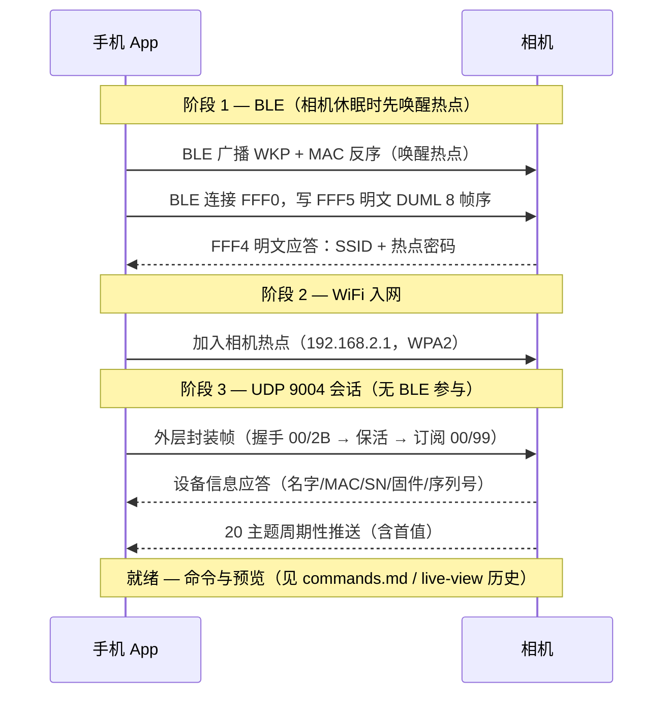

# DJI Osmo 远程控制协议（实现指南）

> 本目录是面向应用开发者的**协议实现指南**：只包含已证实内容（真机写入验证、
> 抓包命令→状态对证、CRC 可校验样例、iOS/Android 双源互证），读完即可从零实现
> 一个 OsmoAction4 远程控制 app。
>
> 逆向过程档案（推定、未定项、更正记录）见 [protocol-raw/](../protocol-raw/)，
> 每份文档末尾"证据"节标注溯源。设备标识（MAC/SN/密码）在所有文档中以 `**` 脱敏。

## 协议分层全景

```
┌─────────────────────────────────────────────────────────────┐
│                        应用语义层                            │
│   拍照 · 录像 · 模式切换 · 快门/EV/ISO/白平衡 · 变焦 · 倒计时   │
├─────────────────────────────────────────────────────────────┤
│                  DUML 命令帧（明文，SOF 0x55）                │
│   [SOF][len:2][crc8][src][dst][seq:2][cmdType][set][id]      │
│   [payload][crc16:2]                → duml-frame.md          │
├──────────────────────────────┬──────────────────────────────┤
│   UDP 9004 主通道            │   TCP 7001 辅助通道           │
│   外层封装（平台差异头）      │   秒级心跳 + RTP 信令         │
│   控制命令 + 遥测推送 + 视频  │                → transport.md │
└──────────────────────────────┴──────────────────────────────┘
┌─────────────────────────────────────────────────────────────┐
│                     BLE 辅助通道（配对期）                    │
│   唤醒广播(WKP) → FFF5 明文 DUML 8 帧序 → FFF4 凭据明文应答    │
│   → 连接期 60s 保活                 → discovery-pairing.md   │
└─────────────────────────────────────────────────────────────┘
```

## 连接总时序



## 文档路线（按实现顺序阅读）

| # | 文档 | 内容 | 实现里程碑 |
|---|---|---|---|
| 1 | [discovery-pairing.md](discovery-pairing.md) | 热点唤醒、BLE 凭据获取、入网、设备信息 | 能连上相机 |
| 2 | [transport.md](transport.md) | UDP 9004 外层封装（平台差异）、TCP 7001 | 帧能被相机解析 |
| 3 | [duml-frame.md](duml-frame.md) | DUML 帧逐字段 + CRC 算法与测试向量 | CRC 校验通过 |
| 4 | [commands.md](commands.md) | 全部控制命令参考（payload 编码 + 码表） | 能拍照/录像/调参 |
| 5 | [telemetry.md](telemetry.md) | 订阅机制 + 推送值结构 | 能显示相机状态 |
| 6 | [keepalive-timing.md](keepalive-timing.md) | 保活节奏、轮询/推送分工、事件 | 会话长期稳定 |
| 7 | [platform-notes.md](platform-notes.md) | iOS/Android 官方 app 行为差异 | 对照调优 |

配套资源：[samples/](samples/)（真机样例帧 fixture）、[tools/](tools/)
（CRC 校验、pcap 解析、SysDump OTP、Ghidra 脚本）、
[tools/REVERSE-METHODOLOGY.md](tools/REVERSE-METHODOLOGY.md)（逆向方法与隐私规范）。

## 可信度约定

- 正文只收录**已证实**内容：真机写入验证、抓包命令→状态对证（≤0.4s）、
  CRC 可校验样例帧、iOS/Android 双源一致，四者满足其一
- 推定/未定项不入正文；溯源见各文档末尾"证据"节 → [protocol-raw/](../protocol-raw/)
- 设备标识（MAC/SN/密码/相机名后缀）在所有示例中以 `**` 脱敏
- 实测自 iOS 官方 Mimo 抓包（mimo-ios.pcap，154MB）与 Android 官方 app 抓包
  （3 个 pcap，311MB，4131 帧 CRC 互证）——抓包文件含真实设备流量，不入库
