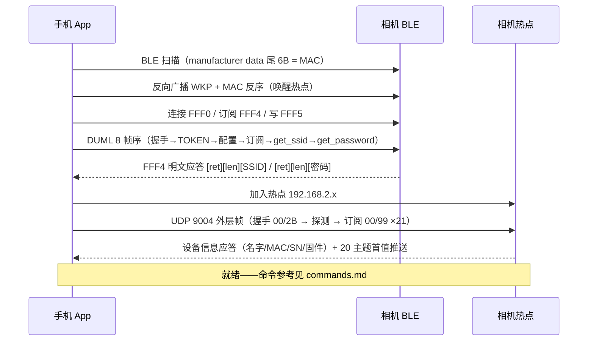

# 发现与配对（discovery-pairing）

> 实现目标：从"相机可能休眠"开始，到"拿到热点凭据并完成入网、建立 UDP 会话、
> 拿到设备信息"。全程无需 root、无需 ECDH——BLE 阶段为明文 DUML。

## 1. 网络形态

相机自带 Wi-Fi AP（休眠时热点关闭，需 BLE 唤醒）：

| 角色 | IP | 说明 |
|---|---|---|
| 相机 | 192.168.2.1 | 同时是 DHCP 服务器；所有命令的目标网关 |
| 手机 | 192.168.2.x | DHCP 分配 |

相机 AP 内**无互联网**；连接期间手机蜂窝流量照常。

端口角色：

| 端口 | 传输 | 角色 |
|---|---|---|
| **9004** | UDP 双向 | 主通道：控制命令、遥测推送、实时预览流 |
| **7001** | TCP 双向 | 辅助：秒级心跳、RTP 信令（见 transport.md） |
| 6001 | TCP | 官方 app 的服务发现探测（SYN 未完成连接）——**实现无需复刻** |

## 2. 步骤 1：唤醒热点（相机休眠时）

相机休眠时热点关闭。App 通过 **BLE 反向广播**唤醒：

```
广播 payload（manufacturer data）:
[len=10] [0xFF] ['W' 'K' 'P'] [MAC 反序 6B]
```

- MAC 来源：本地缓存优先；无缓存时扫描相机 BLE 广播——
  **manufacturer data 尾 6 字节 = 相机 MAC**（与 `wifi_get_mac` 应答一致）
- 广播 2 轮 × 2.5s（变体 A：9B 裸 WKP+MAC 反序；变体 B：2B 占位 CID 前缀），
  随后等 6s 让相机开热点
- iOS 注意：系统会在 manufacturer data 前加 2 字节 CID，必须用
  `peripheralManagerDidStartAdvertising` 回调确认广播成功

> ⚠️ 冷态（热点完全关闭）下唤醒广播的有效性**未验证**——已验证场景均为热点
> 本就开启（BLE 可连）。实现时对唤醒失败做超时降级（提示用户手动开相机）。

## 3. 步骤 2：BLE 凭据获取

1. 扫描名称前缀 `Osmo`/`OA4`/`OA5` → 连接 → 发现服务 **FFF0**
2. 订阅 **FFF4**（notify，应答通道）；写通道 **FFF5**（withResponse）
3. 特征就绪 0.5s 后，**同一 ATT 连发 8 帧明文 DUML**：

| # | dst | cmdType | cmdSet | cmdId | payload | 用途 |
|---|---|---|---|---|---|---|
| 1 | **F0** | 0x40 | 00 | 2B | `04 00` | 握手 |
| 2 | **07** | 0x40 | 07 | 45 | TOKEN（40B） | TOKEN 验证 |
| 3 | **88** | 0x40 | 00 | 32 | `31 31 00 00 00` | 配置 |
| 4 | **88** | 0x40 | 00 | 32 | 同上 | 配置 #2 |
| 5 | **08** | 0x40 | 02 | 8E | `00 01 1C 00` | 订阅 pid 0x001C |
| 6 | **08** | 0x40 | 08 | 79 | `00` | 查询 |
| 7 | **07** | 0x40 | 07 | 07 | `00` | get_ssid |
| 8 | **07** | 0x40 | 07 | 0E | `00` | get_password |

**dst 是关键校准点**（两次抓包一致）：握手→F0、TOKEN/凭据→07（WiFi 模块）、
配置→88、订阅/查询→08。dst 错配会被 0xE0 拒绝且后续被无视。

- 帧格式与 CRC 与 WiFi 侧 DUML 完全相同（见 [duml-frame.md](duml-frame.md)），
  src=0x02、seq 从任意值递增
- TOKEN 帧（40B）格式 `[0x20][16B 密钥][0x04][4B 数字][01 01]`，前 17 字节跨会话稳定；
  可缓存复用（UserDefaults/等价存储）

4. **应答解析**（FFF4 通知 → 帧缓冲 → DUML 解析）：`(07,07)` 与 `(07,0E)` 的
   payload = `[ret:1][len:1][明文 UTF-8]`——**SSID 与密码均为明文，无认证无 ECDH**
5. 凭据到手即持久化（SSID、密码分 Keychain/本地存储管理）

> ⚠️ 历史教训：native 反汇编显示存在 ECDH+AES 加密栈（见 protocol-raw/ble-provisioning.md），
> 但 **BLE 阶段实测不需要**——9 种 ECDH 变体帧无应答，明文应答两次实测。

## 4. 步骤 3：热点入网

1. 用拿到的 SSID/密码配置入网（iOS：`NEHotspotConfiguration`，`joinOnce=false`；
   apply 失败 code=8 时先 `removeConfiguration` 再重试）
2. apply 成功后**轮询确认实际接入**（iOS 上网络可能被系统切回可上网网络；
   SSID 读取受定位门控）
3. 历史坑：入网失败的根因是凭据错误而非系统 API——凭据来自 BLE 明文应答后即稳定

## 5. 步骤 4：UDP 会话与设备信息

入网后直接对网关（相机 192.168.2.1）建立 UDP 9004 会话（外层封装见
[transport.md](transport.md)），DUML 命令即刻可用。断线重连**全程无 BLE**
（凭据已持久化，直接入网）。

连接即发的设备信息查询/应答（DUML (cmdType, cmdSet, cmdId) → payload 内容）：

| 三元组 | 方向 | 内容 |
|---|---|---|
| (0xC0, 0x07, 0x07) | S2C | 相机名（如 `OsmoAction4-****`） |
| (0xC0, 0x07, 0x0C) | S2C | WiFi MAC / 蓝牙 MAC（各一帧） |
| (0xC0, 0x07, 0x0E) | S2C | 13 字节设备串 |
| (0xC0, 0x07, 0x19) | S2C | 地区码 |
| (0xC0, 0x00, 0x32) | S2C | RTC 时间 + 序列号（SN） |
| (0xC0, 0x00, 0x76) | S2C | JSON 产品信息（product_line_type/fw_version 等） |
| (0xC0, 0x00, 0x01) | S2C | 固件版本串 |

## 6. 配对时序图



## 证据

- [protocol-raw/discovery.md](../protocol-raw/discovery.md)（网络形态与端口）
- [protocol-raw/connection-implementation.md](../protocol-raw/connection-implementation.md)
  （真机验证的帧序表与 dst 校准）
- [protocol-raw/ble-provisioning.md](../protocol-raw/ble-provisioning.md)
  （BLE 命令空间；加密假设已被实测推翻，见其头部修正）
- [protocol-raw/cmd-map-android-csdk.md](../protocol-raw/cmd-map-android-csdk.md)
  （Android 官方 app 设备信息响应实证）
